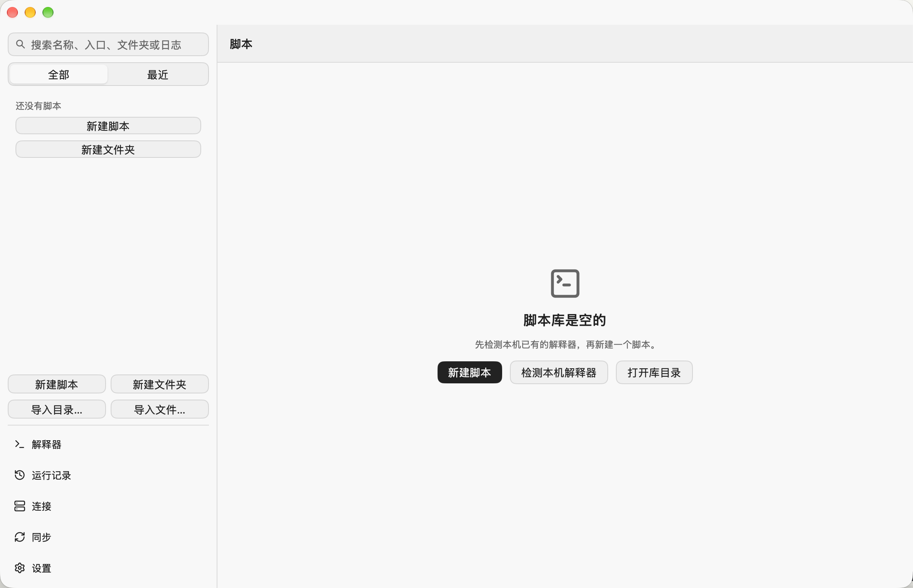

<div align="center">
  
  <h1>script-manager</h1>
  <p><b>把散落在各处的脚本收进一个桌面应用：一个目录就是一个脚本，随手改、随手跑、留得住、还能扔到服务器上跑</b></p>
  <p>本机 macOS / Windows / Linux，远程只认 Linux 服务器</p>
  <a href="https://github.com/MrLsss/script-manager/releases"></a>
  <a href="https://github.com/MrLsss/script-manager/commits"></a>
  <a href="LICENSE"></a>
  
</div>
 

> 脚本库就是一个普通文件夹，也是它自己的 Git 仓库。换电脑、上服务器、用 `git` 看历史，都还是你熟悉的那套东西。

## 特性

- **脚本即目录**：每个脚本是 `scripts/<id>/` 下的一个目录，入口文件可以是 `init.sh`，也可以是 `src/main.py`，附属的 `lib/`、配置样例、README 跟着一起走
- **多文件顺手**：单文件脚本和多文件项目共用一套界面，需要时随时加第二个文件，文件树、标签页、入口切换都在脚本页里
- **改完就能跑**：参数、环境变量、工作目录、超时、管理员身份，一套运行配置存下来；输出、退出码、耗时当场可见
- **跑崩了能回退**：运行前先做语法检查，每次保存和运行前都给整个目录留一份快照，随时恢复到任一版本，也能用 Git 同步到自己的仓库
- **远程只认 Linux**：脚本目录按修订上传到服务器执行，用系统 `ssh` 认证，应用不存密码和私钥
- **待在菜单栏**：关窗口不退出，图标常驻，快速运行面板支持搜索、分组和最近运行

## 快速开始

从 [Releases](https://github.com/MrLsss/script-manager/releases/latest) 下载对应平台的安装包：

| 平台 | 文件 |
| --- | --- |
| macOS 12+（Intel / Apple Silicon） | `script-manager-<版本>-<arch>.dmg` |
| Windows x64 / ARM64 | `script-manager-setup-<版本>-<arch>.exe` |
| Linux x64 / ARM64 | `script-manager_<版本>_<arch>.deb`、`script-manager-<版本>-linux-<arch>.tar.gz` |

每个 Release 都带一份 `SHA256SUMS`，下载后可以先核对。

第一次打开：

1. 到「解释器」页点「检测本机解释器」，把 python3、node、zsh 这些找出来
2. 「新建脚本」，选语言和位置；已有项目直接「导入目录…」
3. 在编辑器里写，`⌘S` / `Ctrl+S` 保存
4. 点页头「运行」，输出和退出码出现在下方运行面板
5. 想随时跑就关掉主窗口，图标留在菜单栏

需要参数、换解释器或换运行目标，都在脚本页头：`解释器 → 参数 → 运行/停止 → 运行目标 → ⋯`。

## 界面一览

| 页面 | 做什么 |
| --- | --- |
| 脚本 | 左侧目录树与搜索，右侧编辑器、文件树/标签页、运行面板 |
| 解释器 | 检测、添加、编辑本机解释器，看版本与可用状态 |
| 运行记录 | 按状态筛选，看日志、复制、打开日志文件、再次运行 |
| 连接 | 管理 Linux 服务器，检测连接与远端解释器 |
| 同步 | Git 仓库状态、远端配置、冲突处理、快照 |
| 设置 | 库目录、运行、日志、同步、代理、权限、外观、语言、更新 |

## 常用快捷键

| 快捷键 | 作用 |
| --- | --- |
| `⌘S` / `Ctrl+S` | 保存当前文件 |
| `⌘R` / `Ctrl+R` | 运行当前脚本 |
| `⌘N` / `Ctrl+N` | 新建脚本 |
| `⌘⇧N` / `Ctrl+Shift+N` | 新建文件夹 |

## 功能详解

### 脚本与文件

- 目录树支持嵌套文件夹、重命名、移到回收站；新建时按语言写入起始内容，文件名从脚本名清洗而来，「备份网站」→ `备份网站.sh`
- 文件树支持新建文件/子目录、重命名、删除、在访达（其他系统为文件管理器）中显示、设为入口
- 入口是唯一的运行基准，删除入口会被拒绝，得先换一个
- 超过 2MB 或含 NUL 的文件不在编辑器里打开，但仍参与复制、上传和运行
- 相对路径统一用 `/` 保存，绝对路径、`..`、盘符和 Windows 保留名一律拒绝

### 编辑

- 多标签编辑，每个文件各自维护未保存状态，标签上有圆点提醒
- 语法高亮、行列位置、语言、修订号、保存状态都在状态栏
- 自动识别 UTF-8 / GBK 与 LF / CRLF，保存时按原编码、原换行写回
- 运行前自动保存全部修改；高危脚本在编辑器上方带警告条

### 运行

- stdout 与 stderr 合并进独立日志，界面实时刷新
- 显示状态、退出码、耗时、入口、解释器与修订号，可停止、可超时、可发系统通知
- 支持「运行前检查」：shell 用 `-n`，Python 用 `ast.parse`，JavaScript 用 `--check`；远程也能先检查再上传
- 日志有大小上限，超出截断并标记；重启后上一次没收尾的运行标为「状态未知」，不会假装成功
- 高危脚本每次运行前都要确认，从菜单栏快速运行也会回到主界面确认

### 解释器

- 自动检测 python3、python、node、bun、deno、zsh、bash、pwsh、go、ruby、perl、lua、php、Rscript 等
- 记录路径、版本与可用状态，可手动添加，并能设置参数模板：`{script}` 是入口路径，`{dir}` 是入口目录
- 脚本绑定解释器；入口语言和解释器语言不一致时拒绝运行并提示更换

### 远程执行（Linux）

在「连接」页添加服务器：写 `user@host` 或 `~/.ssh/config` 里的别名即可。

- 认证交给系统 `ssh`、`ssh-agent`、`~/.ssh/config`；「检测连接」会确认 `uname -s`，非 Linux 直接拒绝
- 脚本目录按修订上传到 `~/.script-manager/scripts/<脚本>/<修订>/`，同一修订只传一次，`.ready` 标记用来跳过重复上传
- 上传在后台进行，显示文件数、大小和百分比，可以取消；取消后残留的目录没有 `.ready`，不会被复用
- 远端用探测到的解释器执行入口，工作目录是入口所在目录，`source ./lib/*.sh` 这类相对引用照常可用
- 输出实时回传，退出码用远端标记行带回；运行记录写明机器、入口、远端解释器和远端目录

<details>
<summary><strong>远程执行的限制</strong></summary>

- 只有 Linux 服务器，macOS / Windows 远端会被拒绝
- 应用里不能输入或保存 ssh 密码，也不会改 `known_hosts`
- 远端工作目录固定为入口目录，忽略自定义工作目录
- 「以管理员身份运行」只对本机生效
- 远端主机需要系统 `tar`；从 Windows 远程执行依赖系统自带的 `tar`（Windows 10 以上通常已有）

</details>

### 历史版本

- 每次保存和运行前记录整个脚本目录的快照，保留相对路径、权限位和入口信息
- 历史页列出时间、哈希、文件数、入口，可切换查看任一文件；恢复前确认，未保存的修改会被丢弃
- 可以逐份删除历史，或只留最新一份；单份快照上限 5MB，超限时只跳过历史，保存和运行照常

### Git 同步

- 库目录本身是 Git 仓库，可配 SSH 或 HTTPS 远端
- 启动时只检查领先/落后，不自动拉取；同步会提交本地改动、打快照标签、拉取并推送
- 冲突按脚本目录保存远端版本，可选「保留本机」「使用远端」「两个都保留」
- 快照页能看份数、占用和仓库总大小，可按快照恢复或逐份删除；保留数量设为 10、30、90 或不限，同步成功后自动清理旧标签
- 网络代理同时作用于脚本运行和 Git

### 导入与导出

- **导入目录 / 文件**：先显示将复制的文件数与总大小，带进度条、可取消，取消不留半个脚本；最多 500 个文件、单文件 20MB、总大小 100MB；拒绝符号链接、FIFO 和设备文件；忽略 `.DS_Store`、`.git`、`node_modules`；保留可执行位
- **导出包**：zip 可选带历史，包内含入口、相对路径、哈希和权限位；导入时按目录路径重建、按语言和名称重新绑定解释器，同名脚本可跳过、导入为副本或覆盖

### 菜单栏与快速运行

- 左键：打开主界面；右键：短菜单，含「快速运行…」「最近运行」（最多 5 条）、「全部脚本…」「退出」
- 快速运行面板支持按名称、入口、文件夹和最近日志搜索，按文件夹分组，最近运行置顶
- 每行有明确的「打开」「运行」按钮，点行本身不会执行；Linux 托盘只提供菜单版本

### 脚本库体检与日志脱敏

- 打开库时自动检查：清理中断留下的临时目录、删掉内容已丢失的修订、跳过无法读取的 `script.json`、忽略指向库外的路径
- 日志脱敏默认开启，把 `password`、`token`、`api_key` 等键值、`Bearer` 令牌、AWS `AKIA...`、URL 里的 `user:pass@` 替换为 `***`

### 多语言与更新

- 界面支持跟随系统、简体中文、English；导航、页头、设置、对话框、托盘菜单、运行状态和常见错误都会跟着切
- 自动更新基于 GitHub Releases：构建时用 Ed25519 私钥给更新包和清单签名，App 内置公钥，下载后先校验再安装；有增量包时只下载变化的部分
- 启动后后台检查，菜单和设置页也可以手动检查；更新窗口支持稍后提醒、跳过此版本、自动下载，安装后自动重启
- 更新地址在构建时固定，不需要用户填写仓库；检查走系统代理，且只接受 HTTPS
- macOS 需要 App 位于 `/Applications` 且可写；Windows 的 per-user 安装可直接更新；Linux 的 deb/rpm 由包管理器更新，`tar.gz` + `install.sh` 安装的版本支持自动更新
- 0.3.0 是第一个带自动更新的版本，更早的版本需要手动安装一次

## 数据放在哪

默认库根是 `~/ScriptManager`，可在设置页更换；`SCRIPT_MANAGER_LIB` 可覆盖它。

```text
~/ScriptManager/
  folders.json                      目录树与库版本
  scripts/<脚本ID>/script.json      名称、入口、配置、高危标记、远程目标
  scripts/<脚本ID>/init.sh          入口，位置任意
  scripts/<脚本ID>/lib/*.sh         附属文件
  local.json                        解释器、绑定、运行记录、修订、待处理冲突
  logs/<脚本ID>/<运行ID>.log
  revisions/<脚本ID>/<哈希>/        整目录快照，含 meta.json
  conflicts/                        冲突时保存的远端内容
  .trash/                           删除的文件夹与脚本
```

<details>
<summary><strong>哪些进 Git，哪些只留在本机</strong></summary>

进入 Git 的：`folders.json`，以及 `scripts/` 下每个脚本的 `script.json` 和内容文件。

只属于本机、写在 `.gitignore` 的：`local.json`、`logs/`、`revisions/`、`conflicts/`、`.trash/`、`*.tmp`、`.DS_Store`。

偏好设置：macOS 在 `~/Library/Application Support/script-manager/`，Windows 在 `%AppData%\script-manager`，Linux 在 `~/.config/script-manager/`。远程连接存在偏好目录的 `remote.json`，更新窗口的选项存在 `updater.json`，都不进脚本库，也不会被 Git 或导出包带走。

环境变量：`SCRIPT_MANAGER_HOME` 改偏好目录，`SCRIPT_MANAGER_LIB` 改脚本库根目录。旧版 `library.json` 第一次打开时自动拆分，原文件改名为 `library.json.migrated`。

</details>

## 安全与边界

- 脚本没有系统级沙箱，管理员运行也只依赖系统授权：macOS 用 `osascript … with administrator privileges`，Linux 用 `pkexec`，Windows 用生成的 `.cmd` 包一层 `Start-Process -Verb RunAs`
- 提权运行停不掉子进程，界面把「停止」换成「断开查看」；授权取消记为「未启动」，重启后按状态文件对账
- 不保存 ssh 密码或私钥，不自动信任主机指纹，不关闭 `known_hosts` 校验
- 导入会校验路径、符号链接、大小和数量；日志脱敏是模式匹配，覆盖不了所有自定义格式的密钥
- macOS 产物是临时签名，Windows 产物未签名、未公证，对外分发需要自己配签名

## 从源码构建

需要 Go 1.27 及以上，首次拉依赖要能访问 Go module 代理；构建缓存放在 `.cache/`，已在 `.gitignore` 里。

```bash
# 开发运行
go run .

# 只构建当前平台
go tool mygo build -skip-dmg

# 三端一起构建
go tool mygo build -skip-dmg -skip-installer \
  -platform darwin/arm64,darwin/amd64,windows/amd64,linux/amd64
```

产物在 `dist/`：macOS 是 `dist/darwin-<arch>/script-manager.app`（含 dmg），Windows 是 `dist/windows-amd64/script-manager.exe`，Linux 是 `dist/linux-amd64/` 下的可执行文件、`.deb` 和 `.tar.gz`；不带 `-skip-installer` 时还会额外生成 `.rpm` 与 `PKGBUILD`。设置 `MYGO_UPDATER_PRIVATE_KEY` 后还会生成签名的更新包、增量包和 `update-<平台>.json` 清单；本地不设置时照常构建，只是不生成更新文件。应用配置在 `mygo.json`，图标 `resources/icon.png` 由 `go run tools/icon.go` 生成。

推送 `v*` 标签时，`.github/workflows/release.yml` 会构建三端，用 `MYGO_UPDATER_PRIVATE_KEY` 签名更新包和清单，再通过 `mygo build -upload` 上传到 draft Release；所有平台的清单齐全后由 publish job 发布。仓库 Secrets 需要配置 `MYGO_UPDATER_PRIVATE_KEY`（`go tool mygo keygen` 生成的私钥），对应公钥写在 `mygo.json` 的 `updates.publicKey`。版本说明取自 `CHANGELOG.md` 中与版本号相同的段落。

首次发布前：

```bash
go tool mygo keygen   # 生成 mygo-update.key 和 mygo-update.pub
# 把 mygo-update.key 的内容设为仓库 Secret：MYGO_UPDATER_PRIVATE_KEY
```

私钥只放密码管理器和 CI Secrets，不要提交；丢失后已安装的版本将无法验证后续更新。

## 致谢

界面基于 [egoist/mygo](https://github.com/egoist/mygo) 的 native UI，图标与主题来自 [lobehub/lobe-mygo](https://github.com/lobehub/lobe-mygo)。

## License

MIT，详见 [LICENSE](LICENSE)。
